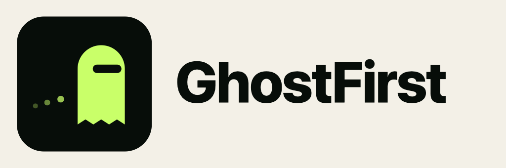

  <picture>
    <source media="(prefers-color-scheme: dark)" srcset="brand/ghostfirst-lockup-dark.png">
    
  </picture>

# ghostfirst-open

The open-source hackathon layer of [GhostFirst](https://ghostfirst.com):
*evidence before the click*. GhostFirst sends a disposable remote browser to a
suspicious link and explains what it saw, before a person or an agent opens it.

The GhostFirst core (verdict engine, backend, and Android app) is private and
is reached over its public HTTP API. This repository contains only the
separable layers built on top of it.

| Folder | What it is | Status |
|---|---|---|
| [`mcp/`](mcp/) | MCP server: a link-safety gate for AI agents and voice assistants (`check_link`, `deep_check`, `get_check_result`, `check_shared_link`), human-only consent, EN/es-US voice and inline MCP Apps card, over stdio or Streamable HTTP, with a voice-assistant simulator | Working; the same code is live at <https://mcp.ghostfirst.com> |
| `lens/` | OpenCV checks (QR sticker overlay, visual timeline evaluation) | Planned |

Design rule for every layer: **AI explains, deterministic rules decide.**

## What you can reproduce from this repo

1. **The whole MCP layer runs from this code:** server, voice simulator, MCP
   Apps card, consent flow and EN/ES wording.
2. **Against the hosted GhostFirst API, with no credentials:** run the server
   locally and it calls `https://ghostfirst.com`, or use the live copy at
   <https://mcp.ghostfirst.com>. The API performs the real browser visits.
3. **Fully offline, with no GhostFirst backend:** `tool/fake_ui_server.py`
   serves the same simulator with fixed fake evidence, and the automated tests
   use mocked API responses. Offline runs show the MCP behavior; real scan
   results come only from the hosted API.

Commands: [`mcp/README.md` → Try it](mcp/README.md#try-it-judges).

The simulator has a session-only shared-links inbox: Share, ask without URL
dictation, then hear complete evidence or use the card. Jobs acknowledge
quickly and are polled; deterministic verdicts never come from AI. No OAuth,
caregiver service or real Echo bridge is connected.

Issues and pull requests are welcome.

License: [Apache-2.0](LICENSE). The license covers the code; the GhostFirst name and logo (`brand/`) are not licensed for use as your own branding.
